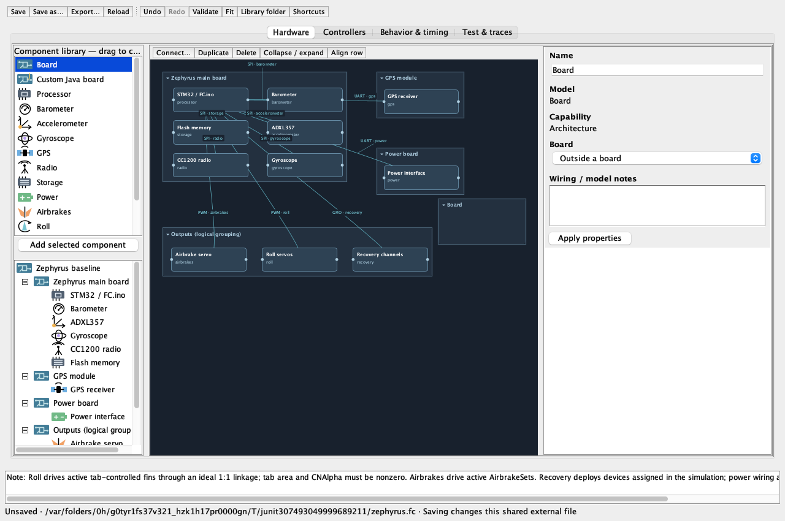
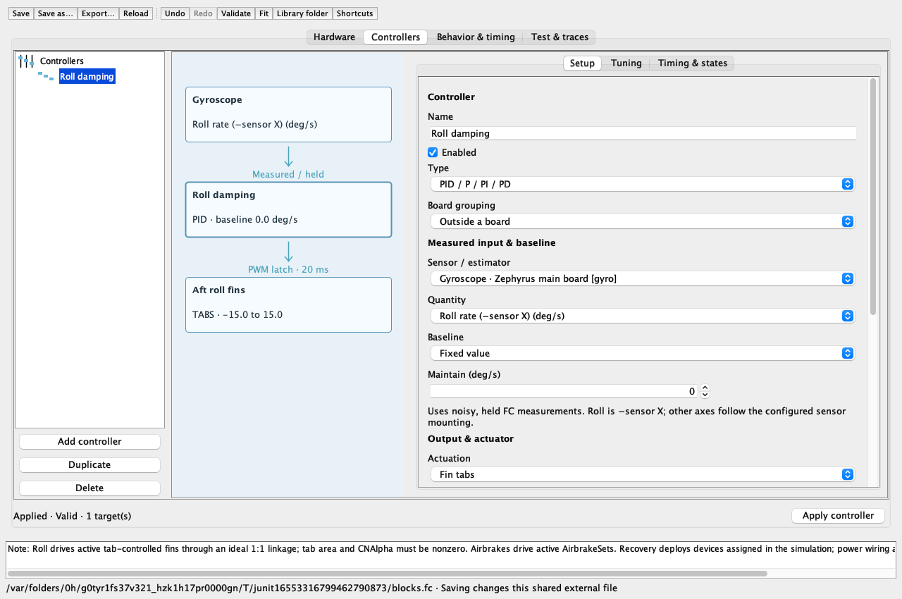
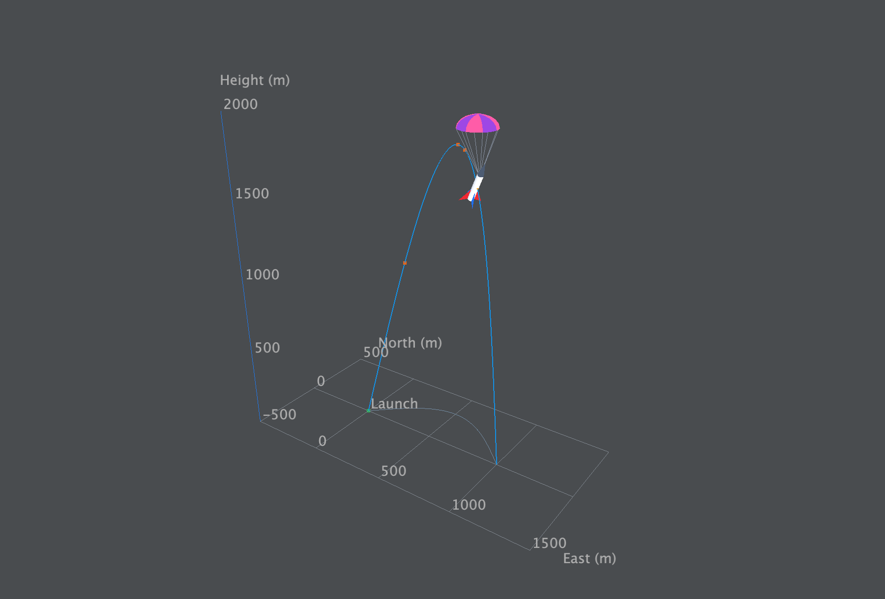
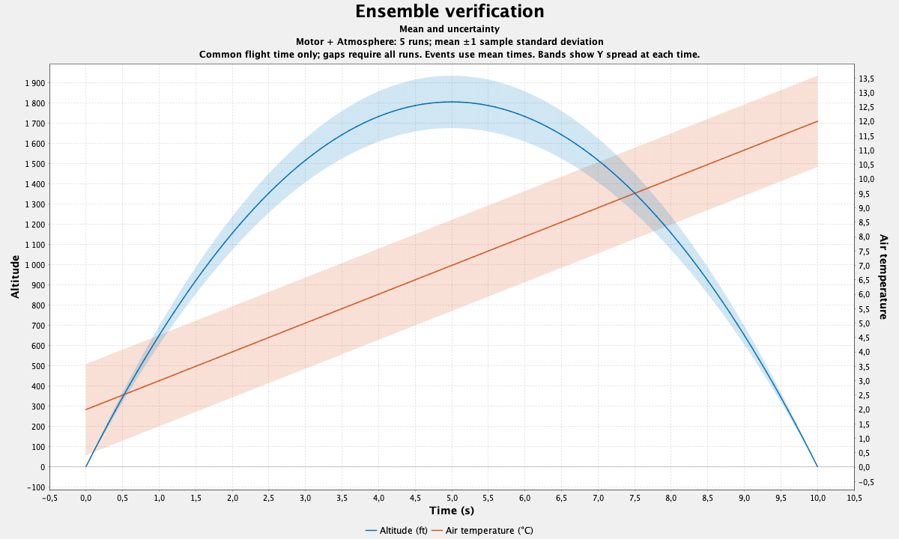
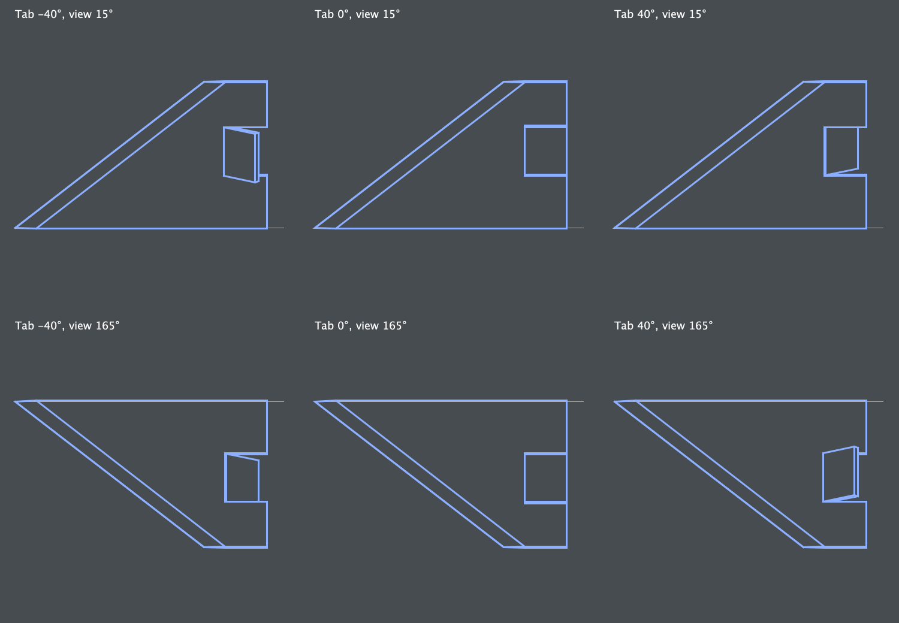
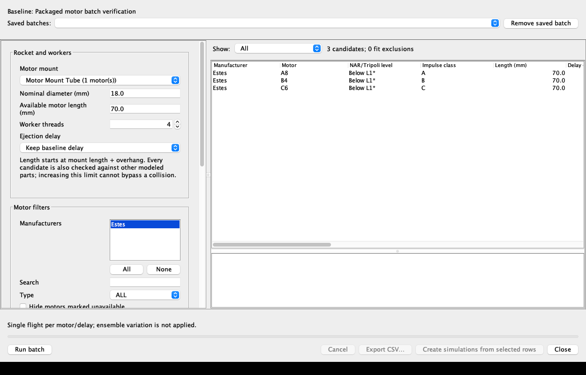

# OpenRocket MIT

**Rocket design, flight-computer development, and active-control simulation in OpenRocket.**

The primary goal of **ActiveControl_MIT_RktTeam** is developing the MIT edition of [OpenRocket](https://github.com/openrocket/openrocket): a desktop environment for designing rockets, testing onboard control algorithms, and understanding flight performance. Flight computers, sensors, control surfaces, recovery events, and telemetry run alongside OpenRocket's flight simulation.

This repository contains the application source, platform packaging, verification tools, and supporting flight data. The earlier Python–OpenRocket experiments remain available under [`sim/old/`](sim/old/).

[**Download releases**](https://github.com/MDNich/ActiveControl_MIT_RktTeam/releases/latest) · [**Feature documentation**](doc/improvements/README.md) · [**Architecture report**](doc/improvements/14-flight-computer-api-and-architecture.pdf) · [**Report an issue**](https://github.com/MDNich/ActiveControl_MIT_RktTeam/issues)

## What's improved

| Area | MIT additions |
| --- | --- |
| **Flight-computer designer** | Graphical boards, sensors, connections, and editable flight states. Portable `.fc` files live in a managed library, with a supplied Zephyrus baseline and simulation-specific references in `.ork` files. |
| **Programmable control** | Custom Java boards with syntax highlighting, completion, external-editor support, and compilation status. Controller blocks provide PID, velocity-weighted PID, and constant outputs, with measured inputs, baselines, and assignments to fin tabs, fin cant, or airbrakes. |
| **Physical actuation and recovery** | Servo commands affect the simulated rocket; FC recovery channels can deploy assigned recovery devices and take authority over OpenRocket's normal deployment rules. Initial launch spin is configurable. |
| **Sensors, timing, and telemetry** | Configurable measurement noise, acquisition intervals, execution costs, and PWM timing. Simulated radio packet loss/delay, selectable CSV/log destinations, measured-versus-physical plots, servo plots, and import of OR-produced FC logs as simulation results. |
| **3D flight playback** | Rotate, pan, and zoom the trajectory with equal spatial scaling. Animate a rocket using recorded attitude, with a velocity arrow, motor exhaust, recovery canopy, and FC state labels. |
| **Uncertainty analysis** | Parallel ensembles with additive Gaussian thrust-curve noise, atmospheric and wind variation, and mass/drag/roll-coefficient uncertainty. Plot the mean and ±1σ bands in 2D, the mean trajectory in 3D, and distributions of flight-summary quantities. Save every run's results in the `.ork`. |
| **Mission Simulation** | A separate map-based configuration workspace, 0–4 ground pointers, standard/custom-FC packets, Telemetry UI software connections, video slates, ensembles, saved-flight ground-link experiments and recoverable `.rktmission` bundles. See the [6.5 user guide](doc/improvements/19-mission-simulation-user-guide.md). |
| **Motor comparison** | Run motor batches with manufacturer and certification filters, physical-fit checks, recovery-delay searches, flight criteria, saved summaries, and CSV export. |
| **Design previews and compatibility** | Fin thickness, fillets, leading-edge profiles, and deflected roll tabs are visible in previews. Export a converted copy for vanilla OpenRocket 24.12, with a summary of the conversion. |

The FC runtime extends OpenRocket's existing simulation listeners. Custom Java boards support rapid algorithm experiments; board communication and servo dynamics remain simplified. See the [architecture and model limits](doc/improvements/14-flight-computer-api-and-architecture.md) for the implemented contracts.

## Screenshots

Captures from the application and its verification views, using example designs and test data. Click an image for full resolution.

| Flight-computer hardware designer | Controller inputs, feedback, and actuator selection |
| --- | --- |
| [](doc/improvements/screenshots/readme/flight-computer-designer.png) | [](doc/improvements/screenshots/readme/controller-editor.png) |
| **3D trajectory and recovery animation** | **Mean trajectories with ±1σ uncertainty bands** |
| [](doc/improvements/verification/trajectory-render-probe.png) | [](doc/improvements/screenshots/readme/ensemble-bands.png) |
| **Roll-tab geometry at different deflections** | **Motor-batch simulation setup** |
| [](doc/improvements/screenshots/readme/roll-tab-preview.png) | [](doc/improvements/screenshots/readme/motor-batch.png) |

<!-- README captures are copied unchanged from swing/build/{fc-designer-verification,fc-controller-verification,ensemble-verification,fin-profile-verification} and sim/FCsim/benchmarking/motor-batch-20261011/macos. The trajectory capture is retained in doc/improvements/verification. -->

## Get started

Download a macOS or Windows package from [GitHub Releases](https://github.com/MDNich/ActiveControl_MIT_RktTeam/releases/latest), or run the release JAR with Java 17. Packaged installers include their Java runtime. The source tree may contain features newer than the published packages; the current development edition is **6.5**.

1. Open or create a rocket and configure its motors and launch conditions.
2. In **Edit simulation → Flight computer**, enable FC simulation, load a `.fc` design, and choose **Edit…** to configure hardware, behavior, Java boards, and controllers.
3. Assign controllers and recovery channels to the rocket's physical components, then run the simulation.
4. Use **Plot data** for FC diagnostics or 3D playback. Enable **Ensemble simulation** under **Simulation options** to explore uncertainty across multiple flights.

Share the external `.fc` alongside the `.ork` when sharing a flight-computer setup. The [designer guide](doc/improvements/06-flight-computer-designer-implementation.md), [controller guide](doc/improvements/13-flight-computer-controller-implementation.md), and [recovery guide](doc/improvements/11-flight-computer-recovery-implementation.md) explain the workflow in detail.

## Build from source

Use **JDK 17** and the included Gradle wrapper. Python is optional and is not required to build or run the desktop application.

```bash
git clone https://github.com/MDNich/ActiveControl_MIT_RktTeam.git
cd ActiveControl_MIT_RktTeam/clone/openrocket-release-24.12.RC.01
./gradlew shadowJar
java -jar build/libs/OpenRocket-MIT-v6.5.jar
```

On Windows, use `gradlew.bat shadowJar`. Run the **root** `shadowJar` task to produce the complete application. The JAR name follows `OpenRocket-MIT-v<version>.jar`; its MIT version comes from [`build.properties`](clone/openrocket-release-24.12.RC.01/core/src/main/resources/build.properties).

From the same Gradle directory:

```bash
./gradlew :core:test :swing:test
./gradlew verifyMitJavadoc rocketTeamJavadoc rocketTeamUml
```

Some Swing and rendering checks need a graphical desktop. Platform packaging instructions are in [`packaging/macos/`](packaging/macos/README.md) and [`packaging/windows/`](packaging/windows/README.md).

## Source and documentation

| Location | Contents |
| --- | --- |
| [`clone/openrocket-release-24.12.RC.01/`](clone/openrocket-release-24.12.RC.01/) | Main application, based on OpenRocket 24.12.RC.01. `core` contains simulation and FC logic; `swing` contains the desktop interface. |
| [`core/…/edu/mit/rocket_team/`](clone/openrocket-release-24.12.RC.01/core/src/main/java/edu/mit/rocket_team/) | Java translation of the Zephyrus firmware. |
| [`core/…/simulation/flightcomputer/`](clone/openrocket-release-24.12.RC.01/core/src/main/java/info/openrocket/core/simulation/flightcomputer/) | FC definitions, custom-board API, controller runtime, sensor models, and physical bindings. |
| [`doc/improvements/`](doc/improvements/README.md) | Feature guides, implementation notes, verification results, [generated Javadoc](doc/improvements/javadoc/index.html), and the [LaTeX architecture report](doc/improvements/14-flight-computer-api-and-architecture.tex). Download the Javadoc directory to browse the HTML locally. |
| [`sim/FCsim/`](sim/FCsim/README.md) | Simulation runners, telemetry benchmarks, flight-data comparisons, and verification utilities. |
| [`packaging/`](packaging/) | macOS/Windows packaging and launcher/update verification. |
| [`sim/old/`](sim/old/README.md), [`doc/FCsim/`](doc/FCsim/), [`bib/`](bib/) | Earlier Python integration, original FC studies, and research references. |

## Upstream and license

This is an MIT Rocket Team development fork of [OpenRocket](https://github.com/openrocket/openrocket). Credit for the original simulator belongs to the OpenRocket contributors. The OpenRocket code is distributed under [GPL-3.0-or-later](clone/openrocket-release-24.12.RC.01/LICENSE.TXT). Please report MIT-edition issues to [this repository](https://github.com/MDNich/ActiveControl_MIT_RktTeam/issues).
