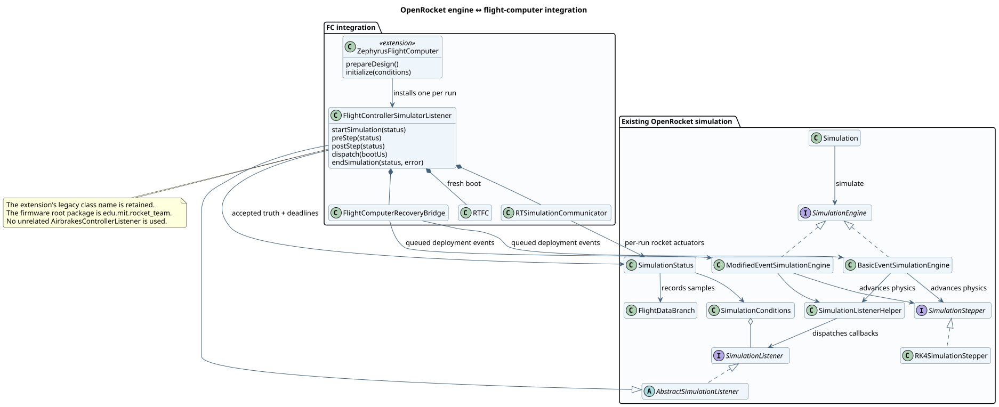
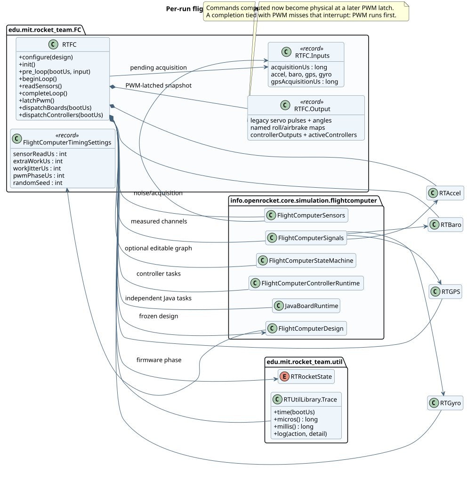
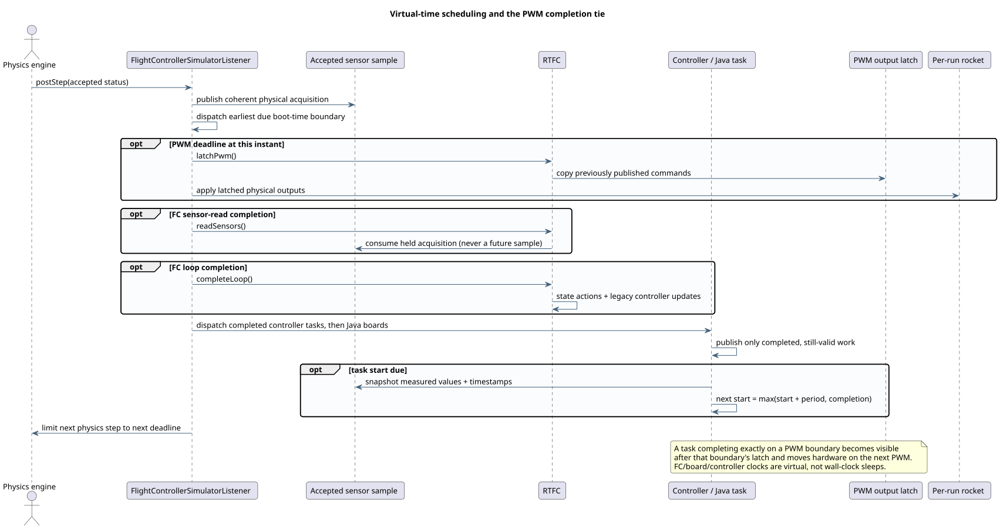
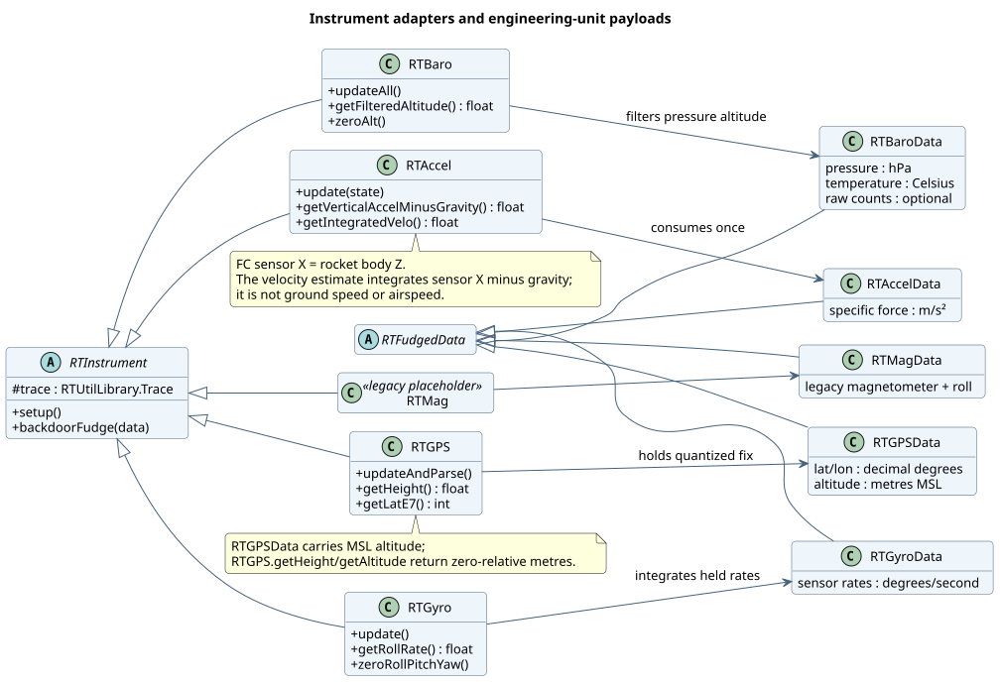
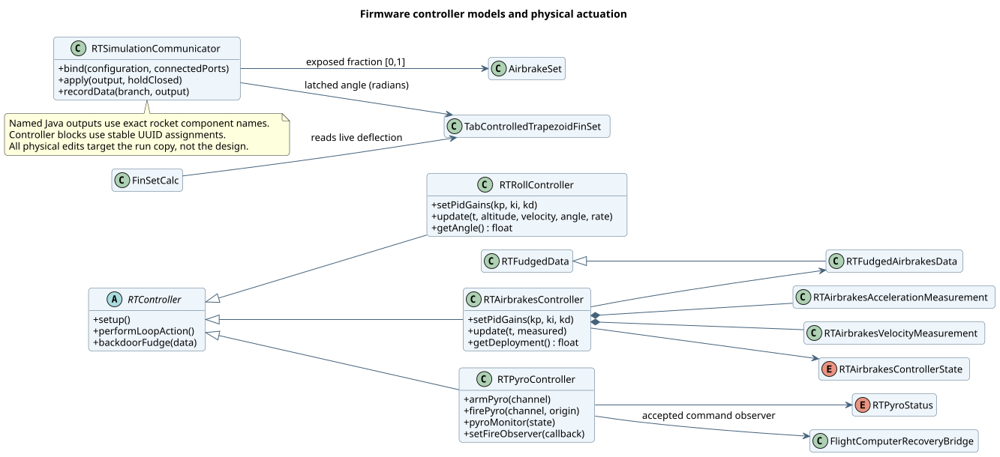
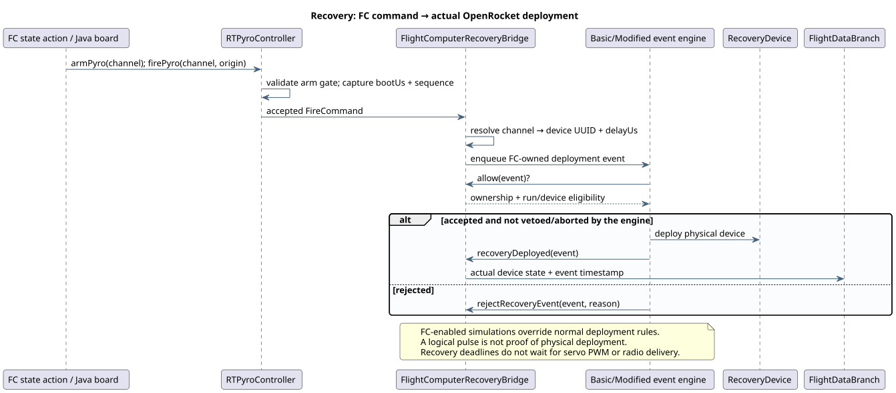
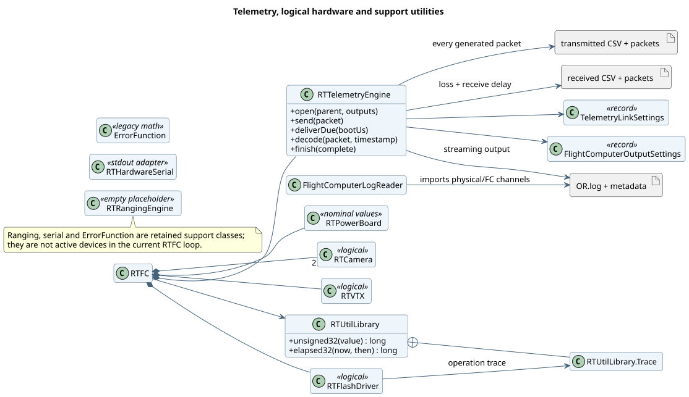
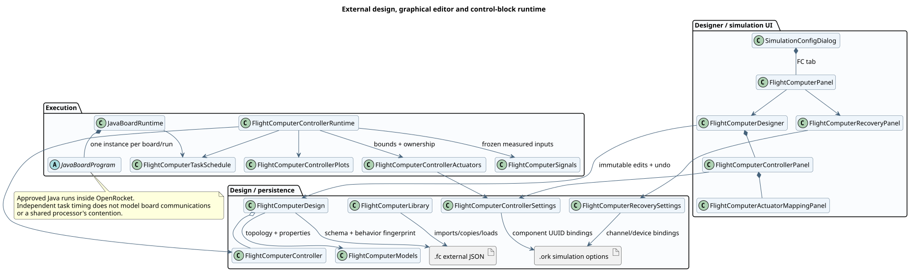
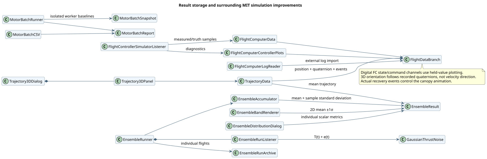

# Flight-computer API and OpenRocket architecture

Updated 11 October 2026 for OpenRocket MIT 6.4.

[Read the LaTeX report (PDF)](14-flight-computer-api-and-architecture.pdf) · [Standalone LaTeX source with native TikZ figures](14-flight-computer-api-and-architecture.tex)

The firmware translation now uses **`edu.mit.rocket_team`** as its root namespace. The former `zephyrus` segment has been removed, while functional subpackages such as `FC`, `instrument`, `control` and `telemetry` remain. The principal entry point is now `edu.mit.rocket_team.FC.RTFC`.

[Open the generated API reference](javadoc/index.html) · [FC runtime package](javadoc/edu/mit/rocket_team/FC/package-summary.html) · [Editable UML sources](uml/)

## What changed, and what stays compatible

The refactor covers the entire translated firmware package and the Java files created for the MIT improvements: designer, controller blocks, physical output/recovery bridges, sensor models, telemetry replay, ensembles, motor batches, 3D plotting, update/memory helpers, tests and standalone verification tools. The source manifest is [`config/mit-documentation-sources.txt`](../../clone/openrocket-release-24.12.RC.01/config/mit-documentation-sources.txt). Existing OpenRocket integration classes appear in the reference through a separate [connector manifest](../../clone/openrocket-release-24.12.RC.01/config/mit-javadoc-connectors.txt).

Methods are expanded to consistent four-space formatting and separated by blank lines. Every explicit method and constructor in the improvement manifest has a Javadoc description, including private helpers and anonymous callbacks. The coverage check does not count compiler-generated record accessors or implicit constructors as source methods. Existing upstream classes included for context are outside this new-method coverage requirement; malformed comments and stale links encountered by the documentation build were repaired.

Update direct firmware imports, for example:

```java
// Previous import: edu.mit.rocket_team.zephyrus.FC.RTFC
import edu.mit.rocket_team.FC.RTFC;
```

There is no compatibility package at the old namespace. External Java source importing those classes must change, and previously compiled clients must be recompiled. Custom boards using the supported `info.openrocket.core.simulation.flightcomputer.JavaBoardProgram` API do not need an import change. Firmware model identifiers, `.fc` schema versions, telemetry byte layouts, existing log prefixes, and the extension class `ZephyrusFlightComputer` retain their identities so saved designs and simulation extension references continue to load. Historical benchmark logs remain historical evidence.

This is a source readability/documentation and namespace change. The before/after Java parser comparison preserves the executable token stream in all 150 pre-existing scoped files after normalizing the namespace. It does not assert that the modeled hardware is physically qualified.

## 1. Where the FC joins the simulation engine



[`Simulation`](javadoc/info/openrocket/core/document/Simulation.html) selects and runs a simulation engine. Both `BasicEventSimulationEngine` and `ModifiedEventSimulationEngine` use the existing listener callbacks; the selected stepper computes the physical trajectory. `SimulationStatus` carries the current physical state, conditions, active components and result branch. `SimulationListenerHelper` dispatches callbacks in the established OpenRocket lifecycle.

The FC extension freezes and validates the selected external design, checks approval of custom Java source, and installs one [`FlightControllerSimulatorListener`](javadoc/info/openrocket/core/simulation/listeners/FlightControllerSimulatorListener.html). The listener creates a fresh `RTFC`, a per-run context, telemetry outputs and physical actuator/recovery bindings. It works on the simulation's rocket copy so servo and cant changes do not modify the user's design.

`preStep` constrains the next physics step to a virtual deadline. Accepted acceleration/status samples provide coherent inputs for acquisition; intermediate or future physical values are not replayed as old sensor samples. `postStep` advances due work and synchronizes FC and physical result channels. End-of-run handling closes output streams and pending recovery work. The separate `AirbrakesControllerListener` is not part of this FC path.

## 2. Runtime composition and clock contracts



`RTFC` owns the translated instruments and firmware controllers. Optional design-defined state graphs, controller blocks and Java boards extend this existing runtime. `RTFC.Inputs` carries acquired engineering values and timestamps; `RTFC.Output` is the PWM-latched output snapshot. Named servo maps and per-controller outputs coexist with the legacy firmware channels.



The important contracts are:

| Boundary | Implemented contract |
| --- | --- |
| Boot versus launch | The listener performs 1,000,000 µs of virtual warm-up; physical simulation time zero follows that warm-up. The preflight command is queued during warm-up at 500,000 µs. |
| Firmware clock | The trace retains unwrapped boot microseconds. Firmware `micros()` and `millis()` reproduce unsigned 32-bit wrap; elapsed calculations use wrapping subtraction. |
| FC loop | Nominal period is 10,000 µs. Sensor-read cost, extra work and seeded jitter are explicit modeled delays. Loop phases cannot overlap. The firmware wait retains millisecond quantization: nominal next start is `(floor(startUs / 1000) + 10) * 1000`, delayed to completion on overrun. |
| Sensor input | A loop uses its held acquisition. Acquisition time and availability time are distinct; GPS age retains the original fix timestamp. A faster controller does not manufacture fresher measurements. |
| Java/controller tasks | Each task has an independent period and modeled execution cost. Inputs freeze at invocation start; outputs publish at completion. Next start is `max(previous start + period, completion)`. |
| PWM | Servo commands latch every 20,000 µs, with configurable phase. At an exact completion/PWM tie, the interrupt sees the previous command. The just-completed value waits for the next latch. |
| State changes | Controller state epochs invalidate in-flight work from an earlier state. Explicit controller-close actions invalidate pending work too. |
| Recovery | Accepted recovery commands retain microsecond completion time and have separate deployment deadlines; they do not wait for PWM or downlink. |

The dispatcher processes a coincident PWM interrupt before FC completion, then controller-block and Java-board work. These are virtual-time contracts, independent of how quickly the desktop executes Java. Hardware execution costs remain user-supplied approximations. Grouping tasks on a board does not model a shared processor's arbitration or real communications between boards.

## 3. Measurements and coordinate conventions



The listener transforms simulator truth into engineering-unit acquisitions. `FlightComputerSensors` applies configured mounting rotation, bias, acquisition cadence and seeded Gaussian measurement noise. `FlightComputerSignals` exposes stable source IDs, channel descriptors, validity and timestamps for controller blocks. Primary sensors retain the firmware filtering/integration path; additional sensors keep independent histories.

| Quantity | Convention |
| --- | --- |
| Accelerometer | Specific force in m/s², with FC sensor X along OpenRocket body Z. The legacy velocity estimate integrates sensor X minus gravity; it is not airspeed or ground-speed magnitude. |
| Gyroscope | Sensor rates in degrees/s. Firmware roll integrates negative sensor X; pitch/yaw follow their corresponding held rates. |
| Barometer | Pressure in hPa, temperature in Celsius. Pressure-derived altitude passes through the configured moving average and zero reference. Heights are metres. |
| GPS | Input coordinates are decimal degrees and input altitude is MSL metres. The adapter quantizes to 1e-7 degrees and millimetres. `RTGPS.getHeight()` and its `getAltitude()` alias return height relative to GPS zeroing. |
| Raw hardware fields | Unavailable pressure/temperature ADC counts can remain NaN. Engineering observations are not evidence of a fully modeled electrical sensor bus. |

Controllers consume measured signals. Physical comparison curves are recorded separately for diagnostics. Reading the same held signal twice does not draw noise twice. `RTMag` is a legacy injection adapter, not an additional active measurement in the current FC loop.

## 4. Controllers, physical ownership and recovery



`RTRollController` retains the sketch's aerodynamic gain schedule and elapsed-time PID behavior. `RTAirbrakesController` retains the FC-included coast predictor and its state sequence; legacy calls keep the integer-second flight-time input and source integral convention. Their control laws are not silently replaced by the generic controller-block PID.

`RTSimulationCommunicator` applies latched airbrake fractions and roll-tab angles to active components in the run copy. FC angle commands are degrees; OpenRocket fin geometry uses radians. Named Java commands address exact, unique rocket component names. An absent FC output discards its command. A present output without suitable physical hardware is diagnosed according to its binding rules.

Controller blocks add PID, velocity-weighted PID, constant output and legacy-controller adapters. Their physical assignments use component UUIDs and separate modes for fin tabs, fin cant and airbrakes. An enabled mapped block reserves its actuator even in inactive states, when it supplies its selected hold/neutral behavior. Java broadcasts skip reserved targets, and conflicting explicit named Java writes are rejected. State-disjoint blocks can share a target under the validated ownership rules. Physical movement is idealized at the PWM latch; servo inertia, backlash and finite travel time are not modeled.



`RTPyroController` implements six logical channels, arming, status and the firmware pulse timer. The accepted fire command carries a sequence, origin and exact boot time. `FlightComputerRecoveryBridge` maps that channel to configured `RecoveryDevice` UUIDs and deployment delays, then submits owned engine events. The engine still applies its deployment checks, listener vetoes and abort conditions. Actual deployment is logged separately from the logical pulse.

When FC simulation is enabled, normal OpenRocket automatic deployment rules are overridden. When it is disabled, the saved normal rules apply again. The logical pulse expires using the firmware's strict elapsed-millisecond threshold; physical deployment scheduling uses the command's microsecond timestamp. Continuity influences firmware status reporting; the `firePyro` command gate itself checks arming, rather than requiring simulated continuity.

## 5. Telemetry and logical hardware



`RTTelemetryEngine` preserves the transmitted packet bytes and decodes them to ground-station-compatible CSV. The received stream adds deterministic loss and delivery delay; it stays separate from the transmitted stream. `OR.log` contains action records and structured physical/FC plot samples. Metadata records paths, settings and completion information. Existing output files are protected against overwrite, and each batch/ensemble member uses distinct output paths.

Telemetry is streamed, although result branches still retain plotted samples and short-period action logs can be large. Packet arrival affects downlink observability rather than changing the physical closed-loop control calculation. `FlightComputerLogReader` reconstructs available plot quantities and actual recovery events without executing custom Java from an imported file.

Camera, video power, flash and power-board classes expose logical operations or nominal values. They do not model RF propagation, electronics, flash wear or battery dynamics. `RTRangingEngine` remains empty, and `RTHardwareSerial` is a standard-output compatibility wrapper.

## 6. Designer, persistence and custom programs



`FlightComputerDesign` is the immutable JSON design and validation boundary; `FlightComputerModels` defines hardware-node capabilities and defaults. `FlightComputerLibrary` imports external `.fc` files into the user's library, resolves references and records fingerprints. Behavior fingerprints exclude presentation-only names/layout. The `.ork` stores the external reference and rocket-specific physical assignments, rather than embedding the portable design as its authoritative source.

The simulation dialog's Flight computer tab opens `FlightComputerDesigner`. Its hardware, behavior, Java and controller editing views apply changes to design snapshots with undo/redo. `FlightComputerControllerPanel` combines algorithm settings, measured-input selection and physical actuator mapping. Recovery assignments remain simulation-specific.

Custom Java source derives from `JavaBoardProgram`; each run creates fresh instances. Compilation does not initialize the program class, and execution requires local approval of the exact source hash. Approved programs execute inside the OpenRocket process; this is not a sandbox. `JavaBoardRuntime` schedules independently configured boards in tandem. It supports algorithm experiments but is not an authoritative model of communications between boards.

## 7. Results, ensembles and the adjacent improvements



`FlightComputerData` and `FlightComputerControllerPlots` record measured-versus-physical quantities, servo outputs, controller diagnostics and state. Digital commands/status use held-value plotting. Structured log metadata preserves channel identities and units during import.

`TrajectoryData` reconstructs position, recorded quaternion orientation, motor burns and recovery events for `Trajectory3DPanel`. The cartoon's attitude follows the recorded orientation, not the direction of velocity. Actual deployment controls the canopy, motor-burn intervals control exhaust, and the current FC state label follows the playhead.

`EnsembleRunListener` applies additive engine variation, `T(t) + e(t)`, during motor burn, plus configured atmospheric variations. `EnsembleAccumulator` aligns member flights in physical time and computes mean/sample-standard-deviation results. The 2D renderer plots mean ±1σ; 3D uses the mean trajectory. Scalar distributions use extrema/metrics from individual flights, and `EnsembleRunArchive` preserves complete members.

`MotorBatchRunner` builds isolated worker baselines from `MotorBatchSnapshot`, records each candidate/delay outcome in `MotorBatchReport`, and exports via `MotorBatchCSV`. The documentation also covers the Windows update helper, memory policy and standalone verification tools; those are maintenance utilities rather than FC runtime dependencies.

## 8. Complete firmware class index

The diagrams show selected operations for readability. The linked Javadoc lists all declared methods, including private ones. Composition diamonds indicate owned runtime state; ordinary arrows indicate use or data flow. Sequence diagrams describe the current implementation's ordering.

| Subpackage | Classes |
| --- | --- |
| `AV` | [RTCamera](javadoc/edu/mit/rocket_team/AV/RTCamera.html), [RTVTX](javadoc/edu/mit/rocket_team/AV/RTVTX.html) |
| `FC` | [FlightComputerTimingSettings](javadoc/edu/mit/rocket_team/FC/FlightComputerTimingSettings.html), [RTFC](javadoc/edu/mit/rocket_team/FC/RTFC.html) |
| `control` | [RTPyroController](javadoc/edu/mit/rocket_team/control/RTPyroController.html), [RTRollController](javadoc/edu/mit/rocket_team/control/RTRollController.html) |
| `control.airbrakes` | [RTAirbrakesAccelerationMeasurement](javadoc/edu/mit/rocket_team/control/airbrakes/RTAirbrakesAccelerationMeasurement.html), [RTAirbrakesController](javadoc/edu/mit/rocket_team/control/airbrakes/RTAirbrakesController.html), [RTAirbrakesControllerState](javadoc/edu/mit/rocket_team/control/airbrakes/RTAirbrakesControllerState.html), [RTAirbrakesVelocityMeasurement](javadoc/edu/mit/rocket_team/control/airbrakes/RTAirbrakesVelocityMeasurement.html) |
| `instrument` | [RTAccel](javadoc/edu/mit/rocket_team/instrument/RTAccel.html), [RTBaro](javadoc/edu/mit/rocket_team/instrument/RTBaro.html), [RTGPS](javadoc/edu/mit/rocket_team/instrument/RTGPS.html), [RTGyro](javadoc/edu/mit/rocket_team/instrument/RTGyro.html), [RTMag](javadoc/edu/mit/rocket_team/instrument/RTMag.html) |
| `internal` | [RTFlashDriver](javadoc/edu/mit/rocket_team/internal/RTFlashDriver.html), [RTPowerBoard](javadoc/edu/mit/rocket_team/internal/RTPowerBoard.html) |
| `telemetry` | [FlightComputerOutputSettings](javadoc/edu/mit/rocket_team/telemetry/FlightComputerOutputSettings.html), [RTRangingEngine](javadoc/edu/mit/rocket_team/telemetry/RTRangingEngine.html), [RTTelemetryEngine](javadoc/edu/mit/rocket_team/telemetry/RTTelemetryEngine.html), [TelemetryLinkSettings](javadoc/edu/mit/rocket_team/telemetry/TelemetryLinkSettings.html) |
| `util` | [ErrorFunction](javadoc/edu/mit/rocket_team/util/ErrorFunction.html), [RTController](javadoc/edu/mit/rocket_team/util/RTController.html), [RTInstrument](javadoc/edu/mit/rocket_team/util/RTInstrument.html), [RTRocketState](javadoc/edu/mit/rocket_team/util/RTRocketState.html), [RTSimulationCommunicator](javadoc/edu/mit/rocket_team/util/RTSimulationCommunicator.html), [RTUtilLibrary](javadoc/edu/mit/rocket_team/util/RTUtilLibrary.html) |
| `util.data` | [RTAccelData](javadoc/edu/mit/rocket_team/util/data/RTAccelData.html), [RTBaroData](javadoc/edu/mit/rocket_team/util/data/RTBaroData.html), [RTFudgedAirbrakesData](javadoc/edu/mit/rocket_team/util/data/RTFudgedAirbrakesData.html), [RTFudgedData](javadoc/edu/mit/rocket_team/util/data/RTFudgedData.html), [RTGPSData](javadoc/edu/mit/rocket_team/util/data/RTGPSData.html), [RTGyroData](javadoc/edu/mit/rocket_team/util/data/RTGyroData.html), [RTMagData](javadoc/edu/mit/rocket_team/util/data/RTMagData.html), [RTPyroStatus](javadoc/edu/mit/rocket_team/util/data/RTPyroStatus.html) |
| `util.hardware` | [RTHardwareSerial](javadoc/edu/mit/rocket_team/util/hardware/RTHardwareSerial.html) |

## 9. Regeneration and validation

From `clone/openrocket-release-24.12.RC.01`, using JDK 17:

```sh
./gradlew formatMitJava
./gradlew verifyMitJavadoc rocketTeamJavadoc rocketTeamUml
./gradlew shadowJar
```

Run formatting before compilation/documentation, rather than concurrently with either. `formatMitJava` pins [google-java-format](https://github.com/google/google-java-format) 1.24.0 with four-space indentation; it preserves import order, unused imports and string literals. The formatter and UML renderer are developer-only dependencies and are not added to the application runtime.

`verifyMitJavadoc` uses the JDK parser to inspect every explicit method/constructor in the manifest, including private methods, test helpers and anonymous callbacks. It fails if a description is absent. `rocketTeamJavadoc` generates this directory's `javadoc/` tree with private members and connected engine types, checking documentation syntax and links. Missing field documentation in pre-existing engine classes is excluded from Javadoc warnings; missing method descriptions in the improvement manifest are checked separately and are not ignored.

`rocketTeamUml` renders the editable `uml/*.puml` sources to SVG with pinned PlantUML 1.2024.8 and its Smetana layout engine. Update these diagrams when relationships or scheduling order change; they are curated architecture views, not automatically inferred behavioral proofs.

The scope manifests must be extended when new improvement classes or verification helpers are added. Generated HTML/SVG files may be regenerated without changing Java behavior. Open `javadoc/index.html` in a browser for searchable API navigation.

Verified for this refactor:

- **1,560 / 1,560 explicit methods and constructors documented**, across the 150 original improvement files and the new parser/audit utility.
- **150 / 150 original source files** preserve parsed Java tokens after ignoring comments/formatting and normalizing the namespace.
- **148 core tests and 65 Swing/UI tests passed**, with zero failures, errors or skipped tests. These include firmware replay, microsecond scheduling, PWM ties, recovery, independent actuator control, controller blocks, ensembles, motor batches, plots, editor lifetime and update routing.
- The root **`shadowJar` build passed**. Its startup class and new `edu/mit/rocket_team/FC/RTFC.class` are present, and there are no entries under the old namespace.
- The generated Javadoc builds successfully with documentation/link checks; all 36 top-level firmware classes appear in the nine rendered UML diagrams.

Artifact: `build/libs/OpenRocket-MIT-v6.4.jar`, with the build's checksum and installed-app compatibility alias. Restart an already-running application to load the renamed classes.
